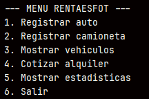
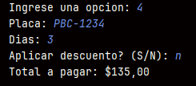
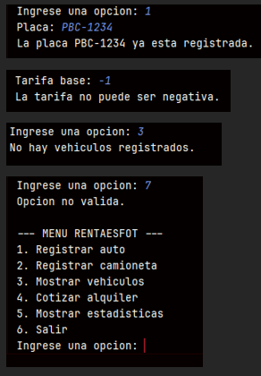

# RentaESFOT
Sistema de alquiler de vehículos en Java con herencia, sobrescritura y sobrecarga.

## Clases
- Vehiculos: clase padre (placa, marca, modelo y tarifa base)
- Auto: agrega puertas y aire acondicionado (+$10 a la tarifa)
- Camioneta: agrega capacidad de carga (+15 % si supera 1.5 t)
- Main: menú del programa

## Capturas

### Menú

### Registro de vehículos

### Mostrar vehículos

### Cotizar alquiler

### Estadísticas

### Errores controlados

